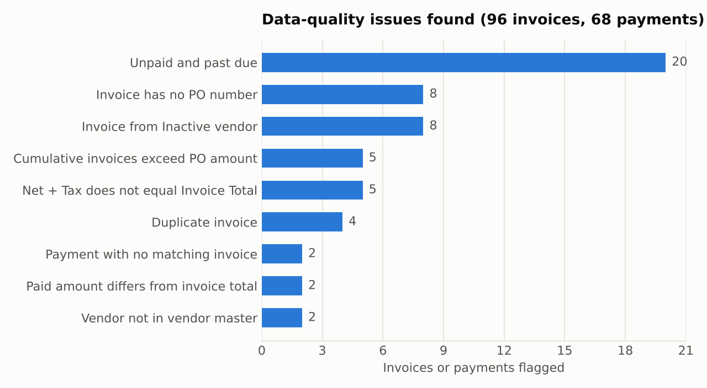
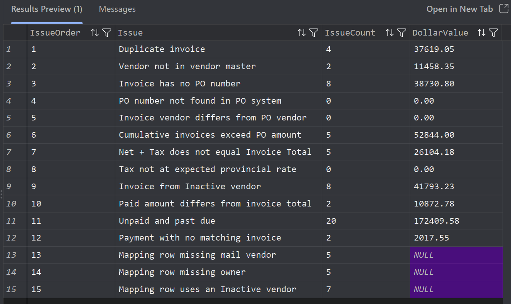
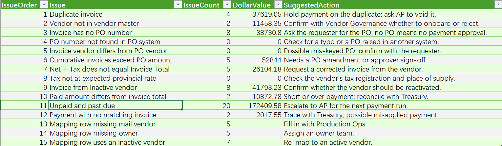
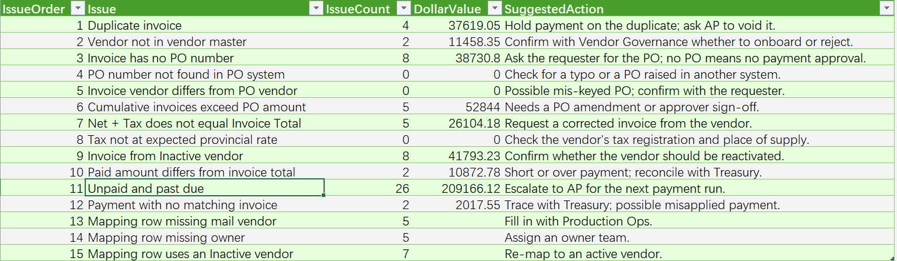
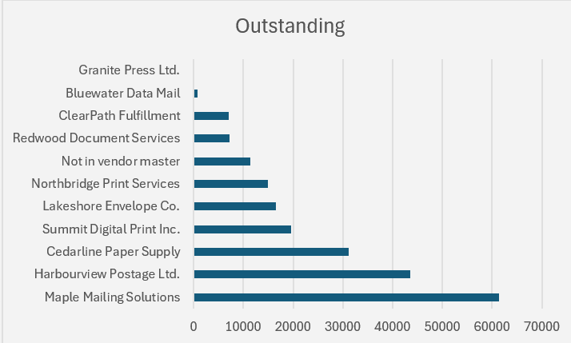
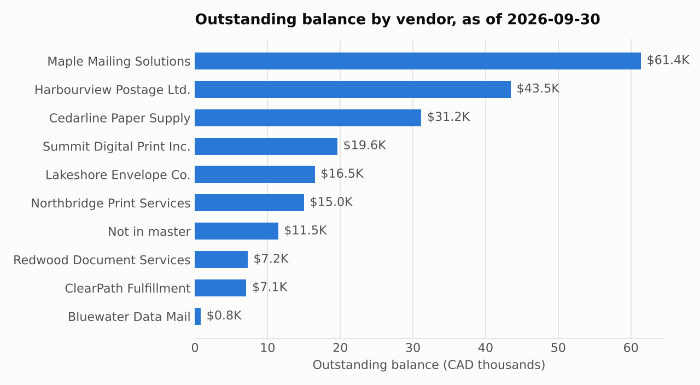

# Vendor Invoice Reconciliation – Print & Post Operations

Reconciles accounts-payable invoices against purchase orders, a vendor master and bank payments for the Print & Post (printing, envelopes, postage, fulfillment) function of a fictional insurance company, then reports data-quality issues and outstanding balances by vendor.

The project is built twice, the way a manual process usually gets upgraded:

| Version | Where the logic lives | Report |
|---|---|---|
| **v1 – Excel only** | Power Query cleans local files; INDEX/MATCH and SUMIFS formulas run the checks | `excel/Invoice_Reconciliation.xlsx` |
| **v2 – Azure SQL** | Raw data loaded to **Azure SQL Database**; cleaning and every check written as **T-SQL views** | Excel connects through **Power Query** and updates with *Refresh All* |

A **Python** (pandas) version reproduces every number as an independent check, and a test runs the SQL logic and compares it with the Python results.

> All data is synthetic, generated by `python/generate_data.py` with a fixed seed. It does not represent any real company.



## Problem

The data lives in four systems that don't agree with each other:

| Source | What was wrong |
|---|---|
| AP invoice export | 27 spellings of 12 vendor names (2 not in the master), 3 date formats, amounts stored as text with `$`, commas and spaces, 4 duplicate rows |
| Purchase orders | Invoices billed beyond the approved PO amount |
| Bank payments | Invoice references missing the hyphen (`INV10041`); payments matching no invoice |
| Application / document-type / vendor map | Missing mail vendors and owners; rows mapped to inactive vendors |

## v2 architecture (Azure SQL)

```
raw files ──► recon.stg_* tables (raw text, as exported)
                    │
                    ▼
        recon.v_invoices_clean / v_payments_clean / v_vendors      cleaning
                    │
                    ▼
        recon.v_invoice_checks / v_payment_checks / v_mapping_checks   validation flags
                    │
                    ▼
        recon.v_issues_summary / v_vendor_summary                   reporting
                    │
                    ▼
        Excel  ──  Power Query (Sql.Database)  ──  Refresh All
```

- The AP export is stored **as raw text** on purpose, so every cleaning rule is visible and versioned in SQL (`TRIM`, `REPLACE`, `TRY_CONVERT` with date styles, `TRY_CAST` to decimal).
- Duplicates are found with `ROW_NUMBER() OVER (PARTITION BY InvoiceNo ORDER BY SourceRow)`; cumulative PO billing with a grouped CTE; the alias catalog is a reference table joined on `UPPER(TRIM(vendor))`.
- The run date lives in `recon.config`. Changing it (or loading new invoices) and pressing *Refresh All* in Excel updates the whole report – no copy-paste.

### Running on Azure SQL

The issue log queried in Azure SQL Database (VS Code, mssql extension). Counts and dollar values match the Excel and Python versions exactly:



**One-click refresh.** Excel reads the views through Power Query. Moving the run date from 2026-09-30 to 2026-10-31 in `recon.config` and pressing *Refresh All* updates the report – unpaid past-due invoices go from 20 ($172,409.58) to 26 ($209,166.12):

| Before refresh (as of 2026-09-30) | After refresh (as of 2026-10-31) |
|---|---|
|  |  |

Outstanding balance by vendor, charted in Excel from `recon.v_vendor_summary`:



## Approach

1. **Clean** – trim text, convert text amounts to numbers, parse mixed date formats, normalize bank references, derive payment-term days.
2. **Catalog** – a vendor alias reference table maps every vendor spelling (upper-cased, trimmed) to a master VendorID; unmatched names become `UNKNOWN`.
3. **Validate** – 11 invoice-level checks plus payment and mapping checks:

   | Check | Rule |
   |---|---|
   | Duplicate | 2nd+ occurrence of the same InvoiceNo |
   | Unknown vendor | Vendor spelling not in the alias table |
   | Missing PO / PO not found / PO vendor mismatch | PO blank, not in PO system, or raised for a different vendor |
   | Over PO | Cumulative net invoiced on a PO > approved amount (duplicates excluded) |
   | Total mismatch | \|Net + Tax − Total\| > $0.01 |
   | Tax rate | Tax ≠ Net × provincial rate (rounded) |
   | Inactive vendor | Vendor status is Inactive |
   | Payment mismatch | Amount paid ≠ invoice total |
   | Overdue unpaid | Nothing paid and due date (invoice date + terms) before the as-of date |
   | Orphan payment | Payment reference matches no invoice |

4. **Summarize** – issue log with count, dollar value and suggested action; invoiced / paid / outstanding by vendor; ageing of unpaid invoices.
5. **Document** – data dictionary (in the workbook) and commented SQL.

## Results (as of 2026-09-30)

- **42 of 96 invoices (44%)** had at least one issue
- $654,664.51 invoiced after removing duplicates; $213,691.27 outstanding, of which **$172,409.58 is past due** across 20 invoices (12 of them 60+ days)
- **$37,619.05** in duplicate invoices at risk of double payment
- 5 invoices push 3 POs over their approved amount; 5 invoices have net + tax ≠ total
- 2 orphan payments and 2 short/over payments need tracing with Treasury
- Three checks found nothing (PO not found, PO vendor mismatch, tax rate) – controls that passed are reported too



### Recommendations

1. Hold the duplicates and have AP void them before the next payment run.
2. Require a PO amendment before approving invoices that exceed their PO.
3. Return invoices with arithmetic errors to the vendor for correction.
4. Replace free-text vendor entry in AP with a dropdown sourced from the vendor master, which removes alias drift at the source.
5. Fill the gaps in the application / document-type map and re-map rows that point to inactive vendors.

## Repository

```
data/raw/                five source files
data/reference/          vendor_aliases.csv (the alias catalog)
sql/                     01_create_tables · 02_load_data · 03_views · 04_analysis_queries (T-SQL)
power_query/azure/       Excel queries that read the Azure SQL views
power_query/local_files/ v1 queries that clean the raw files directly
excel/                   Invoice_Reconciliation.xlsx (v1 workbook)
python/                  generate_data · reconcile · make_charts · make_load_sql
tests/                   test_sql_on_sqlite.py – runs the SQL logic and compares with Python
output/                  CSVs written by reconcile.py
images/                  charts used in this README
```

## How to run

**v2 – Azure SQL + Excel**
1. Create an Azure SQL Database (the free offer is enough) and allow your IP in the server firewall.
2. Run `sql/01_create_tables.sql`, `sql/02_load_data.sql`, `sql/03_views.sql` in order (VS Code with the *SQL Server (mssql)* extension, or SSMS).
3. In Excel: Data → Get Data → From Azure → From Azure SQL Database, or paste the scripts in `power_query/azure/` into blank queries (set `ServerName` and `DatabaseName` first). Load the views and press *Refresh All* whenever the data changes.
4. Try `sql/04_analysis_queries.sql` for top outstanding vendors, ageing buckets and over-PO detail.

**v1 – Excel only:** open `excel/Invoice_Reconciliation.xlsx` (start with *Findings*). To rebuild its tables, paste the scripts in `power_query/local_files/` into blank queries and set `FolderPath` to your `data/raw/` folder. Lookups use INDEX/MATCH; the Excel 365 equivalent is
`=XLOOKUP(UPPER(TRIM(B2)), Vendor_Aliases[AliasKey], Vendor_Aliases[VendorID], "UNKNOWN")`.

**Python**
```bash
pip install pandas openpyxl matplotlib
python python/generate_data.py      # optional: regenerates data/raw
python python/reconcile.py          # prints the issue summary, writes output/
python python/make_charts.py        # redraws images/
python python/make_load_sql.py      # regenerates sql/02_load_data.sql
python tests/test_sql_on_sqlite.py  # SQL logic vs. Python results
```
Excel, SQL and Python agree on every count and dollar value.

## Skills

Azure SQL Database · T-SQL (CTEs, window functions, views) · Excel (Power Query, INDEX/MATCH, SUMIFS / COUNTIFS, conditional formatting, charts) · Python (pandas) · data cleaning · reconciliation · data cataloging · data-quality documentation
